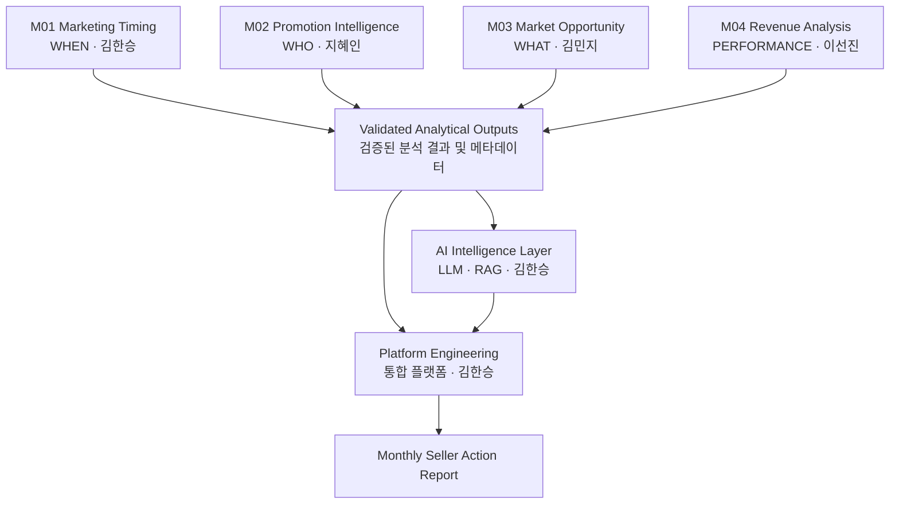

# GrowthLens — Commerce & Marketing Intelligence Platform

> 네이버 스마트스토어 소규모 판매자(1~3인 운영, 전담 분석 인력 없음)를 위한 데이터 기반 시장 기회 탐지 및 판매·마케팅 의사결정 지원 플랫폼

**현재 단계: 프로젝트 초기화 및 기획 문서화 (2026-11-25)**

분석 모델, 플랫폼, LLM·RAG 기능은 **아직 구현되지 않았습니다.**

## 레포지토리 구성

GrowthLens는 4개 레포로 운영합니다. 이 레포는 **문서·주간일지 관리용 메인 레포**이며 코드는 포함하지 않습니다.

| 레포 | 공개 | 용도 | 주 사용자 |
|---|---|---|---|
| [growth-lens](https://github.com/AI-Campus-1st/growth-lens) (이 레포) | Public | 메인: 기획·설계 문서, 주간일지, 회의록, 협업 규칙 | 전원 |
| [growth-lens-data](https://github.com/AI-Campus-1st/growth-lens-data) | Private | 데이터 파이프라인: 수집·전처리·SQL·M01~M04 분석·표준 출력 | 모듈 담당 4인 |
| [growth-lens-backend](https://github.com/AI-Campus-1st/growth-lens-backend) | Private | 백엔드: API, 공통 AI 계층(LLM·RAG·평가), 월간 리포트 | 김한승 |
| [growth-lens-frontend](https://github.com/AI-Campus-1st/growth-lens-frontend) | Public | 프론트엔드: 홈·모듈 화면·AI Assistant·리포트 화면 | 김한승 (+모듈 담당 협업) |

> Private 레포는 팀원만 열람할 수 있습니다(외부에는 404로 보임). 레포 이름·공개 범위는 2026-11-25 팀 결정, 원격 생성 여부는 각 링크로 확인하세요.

---

## 1. 프로젝트 개요

GrowthLens는 소비자 관심도가 상승하면서 경쟁 부담이 상대적으로 낮은 상품군을 발굴하고, 마케팅 적기, 고객 타겟팅 전략 및 판매 성과를 분석하여 소규모 셀러의 의사결정을 지원하는 프로젝트입니다.

| 항목 | 내용 |
|---|---|
| 프로젝트명 | GrowthLens |
| 산업 분야 | Commerce & Marketing |
| 주요 사용자 | 네이버 스마트스토어 소규모 셀러 |
| 프로젝트 인원 | 4명 |
| 개발 기간 | 5~8주 |
| 분석 산업 | 패션·잡화, 뷰티, 식품, 생활·건강 중 1개 분야(미정) |
| 최종 산출물 | 통합 분석 플랫폼, AI 브리핑, 분석 보고서 |
| 프로젝트 기획안 | [PROJECT_PROPOSAL.md](PROJECT_PROPOSAL.md) |

### 해결하려는 4가지 질문

| 구분 | 질문 | 모듈 | 담당 |
|---|---|---|---|
| WHAT | 어떤 상품군을 탐색해야 하는가? | M03 Market Opportunity | 김민지 |
| WHEN | 마케팅은 언제 준비해야 하는가? | M01 Marketing Timing | 김한승 |
| WHO | 어떤 고객이 마케팅에 반응하는가? | M02 Promotion Intelligence | 지혜인 |
| PERFORMANCE | 어떤 상품·프로모션이 매출에 기여하는가? | M04 Revenue Analysis | 이선진 |

**공통 AI 계층(LLM·RAG·AI 브리핑·평가), 플랫폼 개발 및 통합, PM: 김한승**

> **모듈 표기 규칙**: 문서·이슈·PR에서 모듈은 담당자와 함께 `M01(김한승)` `M02(지혜인)` `M03(김민지)` `M04(이선진)` 형식으로 적습니다. 코드 폴더명(`m01_timing` 등)은 담당 변경에 대비해 사람 이름 없이 유지합니다.

---

## 2. 서비스 구조



네 개의 분석 모듈은 독립적으로 개발하고 검증하며, 공통 데이터 규격과 분석 인터페이스를 통해 하나의 플랫폼으로 통합합니다.

서로 다른 데이터셋을 동일한 판매자나 고객의 데이터처럼 결합하지 않습니다.

---

## 3. 분석 모듈

### M01. Marketing Timing (김한승) — 마케팅 적기 분석

**담당: 김한승**

> 소비자 관심도가 증가한 뒤 마케팅을 시작하는 것은 이미 늦은 것이 아닐까?

- 상품군별 관심도 및 시즌성 분석
- 검색과 쇼핑 클릭 간 선행·후행 관계 분석
- 날씨, 공휴일 등 외부 요인 분석
- 관심도 상승 시점 예측
- 상품 소싱 및 마케팅 준비 일정 제안

**활용 데이터:** 네이버 검색어 트렌드, 쇼핑인사이트, KOSIS, 기상청, 공휴일 데이터

**분석 기법:** 시계열 분석, STL 분해, 교차상관 분석, 변화점 탐지, 시계열 예측

**검증 방법:** Rolling Backtest, MAE, RMSE, 상승 시점 탐지 성능

### M02. Promotion Intelligence (지혜인) — 마케팅 효과 분석

**담당: 지혜인**

> 할인하지 않아도 구매할 고객에게 쿠폰을 지급하고 있는 것은 아닐까?

- 광고 처치군·대조군 비교
- 마케팅 증분 효과 분석
- Uplift Modeling 기반 고객 타겟팅
- 일반 구매 예측과 Uplift 모델 비교
- 타겟팅 규모별 증분 전환 효과 분석
- 쿠폰 및 캠페인 효과 분석 가능성 검토

| 개념적 고객 유형 | 전략 |
|---|---|
| Persuadables | 마케팅 우선 대상 |
| Sure Things | 불필요한 혜택 지급 방지 |
| Lost Causes | 마케팅 비용 절감 검토 |
| Sleeping Dogs | 마케팅 노출 주의 |

개별 고객의 실제 인과적 유형을 확정하지 않고, 고객 특성에 따른 증분 효과를 추정합니다.

**활용 데이터:** Criteo Uplift Dataset, The Complete Journey

**분석 기법:** A/B Test 결과 분석, 인과추론, S-Learner, T-Learner, Uplift Modeling

**검증 방법:** ATE, 신뢰구간, AUUC, Qini Score, Uplift@K, 독립 검증 데이터 평가

### M03. Market Opportunity (김민지) — 시장 기회 탐지

**담당: 김민지**

> 수요 관심도는 상승하지만 경쟁 부담은 상대적으로 낮은 상품군은 무엇인가?

GrowthLens의 핵심 시장 기회 탐지 모듈입니다.

| 단계 | 주요 기능 |
|---|---|
| Detect — 감지 | 수요 관심도 급상승, 성장률, 성별·연령·기기별 추이 분석 |
| Diagnose — 진단 | 경쟁 강도, 성장 지속성, 가격 분포, 기회 점수 분석 |
| Recommend — 제안 | 월간 기회 상품군 2~3개 및 선정 근거 제공 |

**활용 데이터:** 네이버 쇼핑인사이트, 검색어 트렌드, 검색광고, KOSIS, 상품 경쟁 데이터(확보 검증 필요)

**분석 기법:** 성장률 분석, 이상 탐지, 다기준 의사결정, 기회 점수 모델링

**검증 방법:** 백테스트, 민감도 분석, 순위 안정성, 데이터 신뢰도 평가

상품 공급 경쟁 데이터를 확보하지 못한 경우 광고 경쟁과 상품 경쟁을 구분하고, 서비스 범위를 재검토합니다.

추천 기준을 충족하지 못하는 경우 상품군을 강제로 추천하지 않습니다.

### M04. Revenue Analysis (이선진) — 판매 퍼포먼스 분석

**담당: 이선진**

> 어떤 상품이 매출에 기여하고 있으며, 광고와 할인·쿠폰은 구매에 어떤 영향을 미칠까?

- 상품별 매출 및 매출 기여도 분석
- 주별·월별 매출 추이 분석
- 상품별 판매 수량 및 구매 빈도 분석
- 할인·쿠폰 금액 및 사용 패턴 분석
- 프로모션 기간별 판매 성과 비교
- M02(지혜인) 광고 효과 분석 결과 연계
- 사용자 입력 기반 손익 시뮬레이션

**활용 데이터:** The Complete Journey, M02에서 검증한 Criteo 분석 결과

**분석 기법:** SQL 기반 매출 집계, ABC 분석, 시계열 분석, 구매 빈도 분석, 프로모션 성과 비교

**검증 방법:** 집계 정합성, 데이터 품질 검증, 통계적 비교 분석

실제 원가, 수수료, 광고비가 없는 경우 실제 이익 또는 ROAS를 산출하지 않습니다.

---

## 4. 공통 플랫폼 및 AI 계층

**담당: 김한승**

### Platform Engineering

- 전체 서비스 아키텍처 설계
- 모듈별 분석 결과 통합
- 공통 UI/UX 및 대시보드
- 데이터 및 분석 인터페이스 관리
- 서비스 배포 및 품질 관리

### AI Engineering

- LLM 기반 분석 결과 해석
- RAG 기반 분석 근거 및 문서 검색
- 근거 기반 AI 브리핑
- 자연어 질의응답
- Monthly Seller Action Report
- 출처 표시 및 응답 품질 평가

### AI 처리 구조

| 계층 | 역할 |
|---|---|
| SQL / Python | KPI, 통계 지표, 예측값 등 정량적 결과 산출 |
| RAG | 분석 보고서, 데이터 정의, 방법론 및 검증된 근거 검색 |
| LLM | 분석 결과 해석, 요약, 질의응답 및 리포트 작성 |

**LLM은 정량적 분석을 대체하지 않습니다.**

실제 수치 질의에는 SQL 또는 검증된 정형 분석 결과를 사용하고, RAG는 관련 문맥과 근거를 제공하는 역할로 설계합니다.

---

## 5. 실험 및 평가 체계

GrowthLens는 분석 모델뿐 아니라 AI 기술 및 서비스 자체의 유효성을 검증합니다.

| 평가 영역 | 검증 방법 | 담당 |
|---|---|---|
| 마케팅 효과 | Criteo 기존 무작위 A/B 실험 재분석 | 지혜인 |
| 타겟팅 전략 | 일반 구매 예측 vs Uplift 모델 오프라인 비교 | 지혜인 |
| 마케팅 적기 | 시계열 백테스트 및 기준선 비교 | 김한승 |
| 시장 기회 | 기회 점수 민감도 및 순위 안정성 | 김민지 |
| 판매 퍼포먼스 | 거래 지표 정합성 및 프로모션 성과 비교 | 이선진 |
| AI 효과 | LLM vs LLM + RAG 오프라인 비교 | 김한승 |
| 플랫폼 효과 | 기존 탐색 방식 vs GrowthLens 사용자 실험(예정) | 전체 |

### A/B 테스트 및 비교 평가 원칙

- 기존 무작위 실험 데이터 재분석과 신규 A/B 테스트를 구분합니다.
- 모델 성능 비교와 RAG 비교 평가를 실제 사용자 A/B 테스트로 표현하지 않습니다.
- 실험 전 가설, 주요 지표, 표본, 최소 탐지 효과(MDE), 분석 방법을 정의합니다.
- 신규 사용자 A/B 테스트는 참가자 확보 및 표본 크기 검토 후 진행합니다.
- 통계적 유의성과 실무적 효과를 구분합니다.
- 실행하지 않은 실험이나 검증 결과를 완료 상태로 기록하지 않습니다.

---

## 6. 핵심 원칙

1. **데이터 우선(Data-First)** — 확보 가능성이 검증되지 않은 데이터에 기능을 약속하지 않습니다.
2. **관측 / 추정 / 시뮬레이션 구분** — 모든 결과에 데이터 출처, 시장(국가), 관측 기간 및 한계를 표기합니다.
3. **LLM은 계산기가 아니다** — 수치는 SQL/Python이 계산하고, LLM은 해석과 서술을 담당합니다.
4. **서로 다른 데이터셋을 동일한 판매자·고객 데이터처럼 결합하지 않습니다.**
5. **상관관계와 인과관계를 구분합니다.** 관측 데이터의 관계만으로 인과적 효과를 주장하지 않습니다.
6. **재현성을 확보합니다.** 데이터 출처, 전처리 과정, 분석 코드, 모델 설정 및 검증 방법을 기록합니다.
7. **비판적 사고를 적용합니다.** 모든 기획과 분석에서 가정, 반론, 한계, 대안 및 실패 가능성을 검토합니다.
8. **불필요한 기술 도입을 지양합니다.** 기술 사용 자체가 아닌 비즈니스 문제 해결을 우선합니다.

---

## 7. 주요 데이터 출처

| 데이터 | 활용 모듈 | 출처 |
|---|---|---|
| 네이버 쇼핑인사이트 | M01(김한승), M03(김민지) | [NAVER API HUB](https://api.ncloud-docs.com/docs/naver-api-hub-overview) |
| 네이버 검색어 트렌드 | M01(김한승), M03(김민지) | [NAVER API HUB](https://api.ncloud-docs.com/docs/naver-api-hub-overview) |
| 네이버 검색광고 | M03(김민지) | [네이버 검색광고](https://ads.naver.com) |
| 온라인쇼핑동향 | M01(김한승), M03(김민지) | [KOSIS](https://kosis.kr) |
| 기상자료 | M01(김한승) | [기상자료개방포털](https://data.kma.go.kr) |
| 공휴일 데이터 | M01(김한승), M03(김민지) | [공공데이터포털](https://www.data.go.kr) |
| Criteo Uplift Dataset | M02(지혜인) | [Criteo AI Lab](https://ailab.criteo.com/criteo-uplift-prediction-dataset/) |
| The Complete Journey | M02(지혜인), M04(이선진) | [Complete Journey](https://bradleyboehmke.github.io/completejourney/reference/index.html) |
| 상품 공급 경쟁 데이터 | M03(김민지) | 확보 방법 검토 중 |

위 데이터는 활용 후보이며 실제 호출, 다운로드, 이용 조건 및 분석 가능성 검증이 필요합니다.

### 데이터 활용 주의사항

- 검색량과 쇼핑 클릭은 실제 판매량이 아닙니다.
- 검색광고 경쟁 정도와 상품 공급 경쟁은 서로 다른 지표입니다.
- 해외 공개 데이터를 국내 스마트스토어의 실제 고객이나 판매 성과로 일반화하지 않습니다.
- M01과 M03의 공통 데이터 및 M02와 M04의 공통 데이터는 중복 수집을 방지합니다.
- 데이터 이용약관 및 재배포 가능 범위를 확인합니다.

---

## 8. 기술 스택

아래 기술은 초기 기획 후보이며 데이터 PoC와 팀 협의 이후 확정합니다. **현재 설치되거나 `pyproject.toml`에 등록된 의존성은 없습니다.**

| 영역 | 기술 후보 |
|---|---|
| Language | Python, SQL |
| Data Processing | Pandas, NumPy |
| Database | PostgreSQL (후보, 미확정) |
| Statistics | SciPy, Statsmodels |
| Machine Learning | Scikit-learn, LightGBM |
| Causal Inference | EconML, CausalML |
| Visualization | Plotly |
| Frontend | 웹 프레임워크 미정 — **Streamlit 미사용**(2026-11-25 결정), 로컬 구현 |
| Backend | API 프레임워크 미정 |
| LLM | LLM API — 제공사 미정 |
| RAG | Embedding, Vector Search, Retrieval Framework — 모델·DB·프레임워크 미정 |
| Testing | Pytest, 데이터 품질 검증 도구 |
| Collaboration | Git, GitHub |
| Deployment | 기술 스택 확정 후 결정 |

Python 버전, 의존성 관리 방식, LLM 모델, 임베딩 모델 및 벡터 데이터베이스는 아직 확정되지 않았습니다.

---

## 9. 프로젝트 디렉터리 구조

### 로컬 작업공간 (권장)

```text
growthlens/                      # 작업공간 폴더 (git 아님)
├── growth-lens/                 # 메인 레포 (Public) — 문서
├── growth-lens-data/            # 데이터 파이프라인 (Private)
├── growth-lens-backend/         # 백엔드·AI (Private)
└── growth-lens-frontend/        # 프론트엔드 (Public)
```

### 메인 레포 (이 레포)

```text
growth-lens/
├── README.md
├── PROJECT_PROPOSAL.md          # 최신 통합 기획안 (v1.3)
├── CONTRIBUTING.md              # 전 레포 공통 Git 협업 규칙
├── AGENTS.md / CLAUDE.md        # AI 코딩 도구 공통 지침
├── .gitignore
└── docs/
    ├── planning/                # 범위, 역할, 로드맵, 리스크, 백로그, 기획안 v1.2(보존)
    ├── data/                    # 데이터 출처·사전·타당성 체크리스트
    ├── architecture/            # 시스템·레포 구조·모듈 인터페이스
    ├── ai/                      # AI 아키텍처, LLM·RAG 전략, 평가 계획
    ├── meetings/                # 회의록
    ├── weekly/                  # 주간일지
    ├── reports/                 # 모듈별 방법론·결과 보고서
    └── experiments/             # (미생성) 실험 설계 문서
```

각 코드 레포의 상세 구조와 경로 소유권은 [레포·디렉터리 구조 문서](docs/architecture/directory_structure.md)를 기준으로 합니다.

---

## 10. 문서 안내

| 영역 | 문서 |
|---|---|
| 통합 기획 | [PROJECT_PROPOSAL.md](PROJECT_PROPOSAL.md) |
| 이전 기획(보존) | [기획안 v1.2](docs/planning/project_proposal_v1.2.md) — 최신본은 `PROJECT_PROPOSAL.md`(v1.3) |
| 프로젝트 관리 | [범위](docs/planning/project_scope.md) · [역할](docs/planning/roles_and_responsibilities.md) |
| 일정 및 리스크 | [로드맵](docs/planning/roadmap.md) · [리스크](docs/planning/risk_register.md) · [초기 백로그](docs/planning/initial_backlog.md) |
| 데이터 | [데이터 출처](docs/data/data_sources.md) · [데이터 사전](docs/data/data_dictionary.md) · [타당성 체크리스트](docs/data/data_feasibility_checklist.md) |
| 아키텍처 | [시스템](docs/architecture/system_architecture.md) · [디렉터리](docs/architecture/directory_structure.md) · [모듈 인터페이스](docs/architecture/module_interfaces.md) |
| AI | [AI 아키텍처](docs/ai/ai_architecture.md) · [LLM·RAG 전략](docs/ai/llm_rag_strategy.md) · [AI 평가 계획](docs/ai/ai_evaluation_plan.md) |
| 실험·평가 | [AI 평가 계획](docs/ai/ai_evaluation_plan.md) · 기획안 [5. 실험 및 검증 체계](PROJECT_PROPOSAL.md#5-실험-및-검증-체계) · `docs/experiments/`(미생성 — 첫 실험 설계 문서 작성 시 생성) |
| 회의·주간일지 | [킥오프](docs/meetings/2026-11-25_kickoff.md) · [주간일지 안내](docs/weekly/README.md) |
| 협업 | [CONTRIBUTING.md](CONTRIBUTING.md) · [AGENTS.md](AGENTS.md) · [CLAUDE.md](CLAUDE.md) |

### 문서 관리 원칙

- `README.md`: 프로젝트 소개 및 개발 가이드
- `PROJECT_PROPOSAL.md`: 최신 통합 기획안
- `CONTRIBUTING.md`: 개발 및 Git 협업 규칙
- `AGENTS.md`: AI 코딩 에이전트 공통 지침
- `CLAUDE.md`: Claude Code 작업 지침
- `docs/`: 세부 기획, 분석 근거 및 의사결정 기록

기획 변경 시 관련 문서를 함께 수정하고, 최신 기획안과 이전 버전의 내용을 혼동하지 않습니다.

---

## 11. 시작하기

### Step 1. 저장소 복제

Private 레포는 Organization 권한이 있어야 clone할 수 있습니다. 본인 담당에 필요한 레포만 받아도 됩니다.

```bash
mkdir growthlens && cd growthlens
git clone https://github.com/AI-Campus-1st/growth-lens.git
git clone https://github.com/AI-Campus-1st/growth-lens-data.git       # 모듈 담당 전원
git clone https://github.com/AI-Campus-1st/growth-lens-backend.git    # 백엔드·AI
git clone https://github.com/AI-Campus-1st/growth-lens-frontend.git   # 프론트엔드
```

### Step 2. 공통 문서 확인

작업 시작 전 다음 문서를 확인합니다.

- README.md
- PROJECT_PROPOSAL.md
- CONTRIBUTING.md
- AGENTS.md
- CLAUDE.md
- 담당 모듈 관련 기획 및 데이터 문서

### Step 3. 개발 환경 구성

팀 공통 Python 버전 확정 후 가상환경을 구성합니다.

```bash
python --version
python -m venv .venv
```

macOS / Linux:

```bash
source .venv/bin/activate
```

Windows PowerShell:

```powershell
.\.venv\Scripts\Activate.ps1
```

의존성 설치 방법은 팀 공통 패키지 관리 방식 확정 후 추가합니다.

개별 팀원이 독립적으로 Python 및 주요 패키지 버전을 확정하지 않습니다.

### Step 4. 환경 변수 설정

`.env.example`은 코드 레포(`growth-lens-data`, `growth-lens-backend`, `growth-lens-frontend`)에 있습니다. 메인 레포에는 없습니다.

macOS / Linux:

```bash
cp .env.example .env
```

Windows PowerShell:

```powershell
Copy-Item .env.example .env
```

각자 발급받은 API Key 및 자격증명을 입력합니다.

**`.env` 파일은 절대 Git에 커밋하지 않습니다.**

### Step 5. 담당 모듈 작업 시작

1. 담당 모듈 및 GitHub Issue 확인
2. 최신 공통 브랜치 확인
3. 작업 브랜치 생성
4. 데이터 확보 및 구조 검증
5. 분석 가설과 검증 방법 정의
6. 코드 및 분석 문서 작성
7. 테스트 후 Pull Request 생성

서비스 실행 방법 및 DB 초기화 명령은 구현 후 추가합니다.

---

## 12. Git 협업 규칙

브랜치 전략, 작업 명령 예시, 커밋 메시지, PR·리뷰 규칙은 **[CONTRIBUTING.md](CONTRIBUTING.md) 한 곳에서만** 관리합니다(제안 상태, 킥오프에서 확정).

- 브랜치: `main` / `develop` / `feature/m01~m04-*` / `feature/ai-*` / `feature/platform-*` / `docs/*` / `fix/*`
- 커밋: `<type>(<scope>): <요약>` — 예: `feat(m03): Opportunity Score 산식 v0 구현`
- 강제 Push, 무단 병합, 다른 팀원 코드 임의 수정 금지

---

## 13. 데이터 관리 및 보안

| 경로 | 관리 원칙 |
|---|---|
| `growth-lens-data/data/raw/` | 원본 보존 및 직접 수정 금지 |
| `growth-lens-data/data/interim/` | 중간 정제 및 변환 데이터 |
| `growth-lens-data/data/processed/` | 최종 분석용 데이터 |
| `growth-lens-data/data/sample/` | 재배포 가능한 최소 샘플 |
| `growth-lens-data/outputs/` | 검증된 분석 결과(표준 출력) |
| `growth-lens-backend/data/knowledge/` | RAG용 검증된 지식 자료 |

Public 레포(`growth-lens`, `growth-lens-frontend`)에는 데이터, API 키, 내부 분석 결과 원본을 올리지 않습니다.

**클론 직후 각 레포에서 1회:** `git config core.hooksPath .githooks` — 비밀값·대용량 파일 커밋을 차단하는 훅을 켭니다. 상세 규칙과 유출 시 대응은 [CONTRIBUTING.md §5](CONTRIBUTING.md#5-보안--비밀값데이터-유출-방지-필수)을 따릅니다.

### 데이터 수집 시 기록 사항

- 데이터 출처 및 수집일
- 데이터 버전 및 관측 기간
- 데이터 스키마 및 분석 단위
- 결측치 및 중복 현황
- 이용약관 및 재배포 조건
- 데이터 수집 및 재현 방법

### Git 및 외부 AI 전송 금지 대상

- API Key 및 `.env`
- 데이터베이스 비밀번호
- 고객 식별정보 및 개인정보
- 기업 내부 비공개 데이터
- 대용량 원본 데이터
- 재배포가 제한된 데이터 및 모델
- 기밀 정보가 포함된 RAG 문서 및 벡터 데이터

대용량 데이터는 GitHub에 직접 업로드하지 않고 데이터 수집 스크립트, 데이터 명세 및 허용된 샘플을 공유합니다.

---

## 14. 모듈별 공통 산출물

각 모듈 담당자는 다음 산출물을 책임집니다.

| 산출물 | 내용 |
|---|---|
| Data Source | 데이터 출처 및 확보 결과 |
| Data Dictionary | 컬럼, 데이터 타입, 지표 정의 |
| EDA | 탐색적 데이터 분석 |
| SQL / Python | 재현 가능한 분석 코드 |
| Methodology | 분석 방법 및 가설 |
| Validation | 모델 및 분석 결과 검증 |
| Visualization | 플랫폼 통합용 분석 시각화 |
| Analysis Report | 분석 결과, 비즈니스 해석 및 한계 |
| Integration Output | 공통 규격에 따른 분석 결과 |

### 분석 결과 공통 메타데이터(후보)

```text
module_id
metric_id
value
unit
period_start
period_end
as_of
entity_id
source_id
market
result_type
method_version
limitations
```

실제 필수 컬럼, 데이터 타입, 불확실성 표현 및 출력 형식은 `docs/architecture/module_interfaces.md`에서 협의 후 확정합니다.

모듈 담당자는 플랫폼 담당자가 분석 로직을 다시 구현하지 않아도 되도록 검증된 결과와 통합 가능한 시각화 산출물을 제공합니다.

---

## 15. 프로젝트 일정

| 주차 | 주요 목표 |
|---|---|
| 1 | 역할·폴더·인터페이스 합의, 데이터 PoC, 경쟁 서비스 조사·사용자 가설 검토 |
| 2 | 수집·정제·DB 설계, 분석 단위와 KPI 정의 |
| 3~4 | 모듈 핵심 분석·모델·검증, 플랫폼 병렬 개발 |
| 5 | 분석 결과 통합, QA, AI 비교 평가 |
| 6 | MVP·리포트·발표 준비 |
| 7~8 | 사용자 검증 및 선택 기능 고도화 |

주차별 목표의 기준은 [PROJECT_PROPOSAL.md §7](PROJECT_PROPOSAL.md#7-일정-및-우선순위), 날짜별 마일스톤 초안은 [로드맵](docs/planning/roadmap.md)을 따릅니다(날짜는 팀 재확인 필요).

6주 MVP 완성을 기본 목표로 설정하며 실제 개발 기간과 데이터 확보 결과에 따라 범위를 조정합니다.

### 첫 번째 담당 업무

| 담당자 | 초기 작업 |
|---|---|
| 김한승 | M01 데이터 PoC, 프로젝트 관리, 공통 인터페이스 및 플랫폼 설계, AI 평가 계획 |
| 지혜인 | Criteo 데이터 확보, 실험 구조 검증, A/B Test 및 Uplift 분석 설계 |
| 김민지 | 네이버 API 검증, 상품 공급 경쟁 데이터 확보, 시장 기회 평가 설계 |
| 이선진 | Complete Journey 확보, 테이블 조인 검증, 매출 및 할인 지표 정의 |

모든 팀원은 데이터 수집 가능 여부와 검증 결과를 문서화합니다. 데이터 확보 실패 시 원인 및 대체 방안을 함께 제시합니다.

---

## 16. AI 코딩 도구 사용 규칙

Claude Code, Codex 등 AI 코딩 도구는 [AGENTS.md](AGENTS.md)(공통)와 [CLAUDE.md](CLAUDE.md)(Claude 전용)를 따릅니다. 작업 요청 공통 양식과 완료 보고 양식도 AGENTS.md에 있습니다.

핵심: 기존 변경 보존 · 담당 범위 외 수정 금지 · 미확인 데이터·결과 생성 금지 · 테스트 실행 여부와 실제 결과 구분 · **승인 없이 커밋·Push·Merge 금지**

---

## 17. 주요 리스크

| 리스크 | 대응 방향 |
|---|---|
| 상품 공급 경쟁 데이터 확보 실패 | 대체 데이터 검증 또는 서비스 범위 재설계 |
| M01과 M03(김민지) 분석 중복 | 공통 수집 파이프라인 활용 |
| M02와 M04(이선진) 분석 중복 | 인과 효과와 실적 분석 구분 |
| 국내·해외 데이터 불일치 | 분석 대상 및 적용 범위 분리 |
| 실제 셀러 고객 데이터 부재 | 전략 검증 및 시뮬레이션으로 제한 |
| 과도한 개발 범위 | 필수 MVP 우선 개발 |
| LLM 환각 및 수치 오류 | 정형 데이터 활용 및 근거 검증 |
| RAG 도입 효과 불확실 | Baseline 대비 비교 평가 |
| 사용자 실험 표본 부족 | 탐색적 결과로 해석 |
| PM·플랫폼·AI 업무 집중 | 모듈 오너십 및 공통 산출물 규격 적용 |

데이터 타당성이 검증되지 않거나 비즈니스 문제와 분석 결과가 연결되지 않는 경우 기획을 수정할 수 있습니다.

---

## 18. 프로젝트 진행 상태

### Project Initialization

- [x] 저장소 구조 및 기획 문서 초안
- [x] 4개 분석 모듈 정의
- [x] 담당자 역할 분담
- [ ] 통합 기획안 및 README 동기화
- [ ] 팀 공통 개발 환경 설정
- [ ] Git 협업 규칙 확정
- [ ] 레포 4개 분리 및 원격 생성

### Data Feasibility

- [ ] 산업 선택
- [ ] 네이버 API 호출 검증
- [ ] 상품 공급 경쟁 데이터 확보 검증
- [ ] Criteo 데이터 확보 및 검증
- [ ] Complete Journey 데이터 확보 및 검증
- [ ] 데이터 이용약관 확인
- [ ] 공통 데이터 스키마 확정

### Module Development

- [ ] M01 Marketing Timing (김한승)
- [ ] M02 Promotion Intelligence (지혜인)
- [ ] M03 Market Opportunity (김민지)
- [ ] M04 Revenue Analysis (이선진)

### Platform & AI

- [ ] 공통 분석 인터페이스
- [ ] 통합 플랫폼
- [ ] LLM 기반 AI 브리핑
- [ ] RAG 시스템
- [ ] Monthly Seller Action Report

### Experiment & Evaluation

- [ ] Criteo A/B 실험 재분석
- [ ] Uplift 모델 비교 평가
- [ ] 시계열 백테스트
- [ ] 시장 기회 점수 검증
- [ ] LLM·RAG 비교 평가
- [ ] 플랫폼 사용자 평가
- [ ] 최종 QA 및 발표

---

## 19. Team

| 이름 | 담당 모듈 | Role | 추가 역할 (제안, 킥오프 확정 전) |
|---|---|---|---|
| 김한승 | M01 Marketing Timing | Project Manager / Platform & AI Engineering | 플랫폼 통합, AI 계층, 주간일지 취합, GitHub 관리 |
| 지혜인 | M02 Promotion Intelligence | Causal Inference | 실험·통계 검증 리뷰, AI 평가셋 검수 |
| 김민지 | M03 Market Opportunity | Market Analysis | 네이버 공통 수집기·수집 데이터 공유 |
| 이선진 | M04 Revenue Analysis | Performance Analytics | 공공데이터 수집(KOSIS·기상청·공휴일), DB·SQL 표준 |

상세 배정·백업·PR 리뷰 페어: [역할과 책임 §5](docs/planning/roles_and_responsibilities.md)

---

**GrowthLens — From Market Signals to Business Decisions**

데이터를 보여주는 것에서 끝나지 않고, 검증된 분석 결과를 바탕으로 비즈니스 의사결정을 지원하는 것을 목표로 합니다.